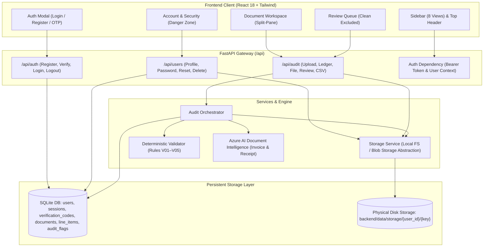

# P05 — UX Redesign, Persistent Document Library & User Account Management Implementation Report

**Document ID:** `P05-UX-ACC-DELIVERY-20261109`  
**System:** Fee Receipt and Invoice Auditor (Institutional Accounting Console)  
**Architecture:** React 18 (Vite, Tailwind CSS) + FastAPI + SQLite (Canonical Decimal Text) + Azure AI Document Intelligence  
**Compliance Standards:** Zero-LLM Financial Validation, Deterministic Rules V01–V05, Fiduciary Multi-User Isolation  
**Date:** November 9, 2026  
**Status:** **FULLY IMPLEMENTED & VERIFIED** (78/78 Backend Tests Passing, 21/21 Frontend Tests Passing, 0 Build Errors)

---

## 1. Executive Summary

This engineering delivery report documents the comprehensive implementation of **UX Redesign, Persistent Document Library, and User Account Management** for the P05 Fee Receipt and Invoice Auditor. 

All non-negotiable architectural constraints were strictly respected:
- Zero LLM-based financial calculations (all arithmetic and checks run deterministically via Python V01–V05 rules).
- The OCR confidence threshold remains locked at 0.85 (85.0%).
- Canonical INR currency formatting (`₹`) and the six canonical INR synthetic documents are fully preserved.
- True server-side multi-user authentication, session management, and tenant isolation are enforced across all database queries and disk storage operations.
- Destructive operations (Document Delete, Reset My Data, Delete Account) require strict re-authentication and typed phrase confirmations.



---

## 2. Phase-by-Phase Implementation Details

### Phase 1: Frontend Information Architecture & Navigation Refactor
1. **8 Distinct Institutional Views**:
   - `dashboard` (`OverviewScreen`): Institutional KPIs (Total Audited Volume in ₹, Clean Documents, Flagged Documents, Exceptions Requiring Review), V01–V05 distribution, recent documents table, and quick actions.
   - `upload` (`UploadScreen`): 3-stage upload workflow (1. Select Files -> 2. Review Staged Files -> 3. Ingest & Verify) with drag-and-drop, <= 20MB client-side check, and direct link to Document Workspace.
   - `documents` (`DocumentsScreen`): Persistent document library featuring multi-select checkboxes, search, status filters, sorting (Date, Amount, Vendor), pagination, bulk deletion, and direct download links.
   - `findings` (`AuditResultsScreen`): Deep-dive audit ledger detailing each rule violation across V01 through V05.
   - `review` (`ManualReviewScreen`): **Clean documents are strictly excluded** (`audit_status === 'clean' && validation_flags.length === 0`). Displays only flagged documents or pending compliance exceptions, with mandatory auditor notes required for approval or rejection.
   - `reports` (`ReportsScreen`): Compliance telemetry, CSV export trigger, and audit distribution charts.
   - `settings` (`SettingsScreen`): Academic term boundary configuration (`Fall 2026`, `Spring 2027`, `Summer 2026`, `AY 2026-27`), OCR threshold display (0.85), dual-model routing overview.
   - `account` (`AccountSecurityScreen`): Auditor identity, verified status badge, Change Password form, and Danger Zone operations.

2. **Responsive Collapsible Sidebar (`Sidebar.jsx`)**:
   - Institutional navy design (`#0f172a` / `#1e293b`).
   - One-click drawer toggle between expanded (`w-64`) and compact collapsed (`w-18`) modes.
   - Real-time exception counter badge on Review Queue.
   - Quick shortcut to auditor profile.

3. **Top Navigation Header (`Header.jsx`)**:
   - Hierarchical breadcrumb (`Auditor Console > <View Name> > <Document Name>`).
   - Academic Term selector dropdown (`Fall 2026`, `Spring 2027`, etc.).
   - Global search input for instantaneous filtering by vendor, invoice ID, or tax number.
   - Profile menu with verified status badge, Settings link, and Sign In / Sign Out actions.

4. **Split-Pane Document Workspace (`DocumentWorkspace.jsx`)**:
   - **Left Pane (Document Viewer)**:
     - Embedded PDF viewer utilizing `/api/audit/documents/{id}/file` endpoint.
     - Toggle between native PDF Binary mode and Parsed Layout Canvas.
     - Zoom in/out, fit-to-width controls, and direct "Download Original" button.
   - **Right Pane (Audit & Extraction Details)**:
     - Extracted financial fields with individual confidence badges.
     - Arithmetic reconciliation section: compares Line Items Sum against Total with explicit discrepancy calculation.
     - Extracted Line Items table with unit prices, quantities, and confidence values.
     - Plain-language V01–V05 validation flags.
     - Interactive Manual Review decision form (Approve / Reject / Pending with mandatory auditor rationale).
     - Full immutable audit history event log.

---

### Phase 2: Persistent Document Library & Storage Layer
1. **Storage Service Abstraction (`backend/app/services/storage.py`)**:
   - Organizes physical files on disk under `backend/data/storage/{owner_user_id}/{storage_key}`.
   - Methods: `save_file()`, `get_file()`, `delete_file()`, `delete_user_files()`.
   - Returns unique UUID storage key, SHA-256 binary hash, byte length, and MIME content type.
   - Clean architectural abstraction designed for immediate Azure Blob Storage client swapping.

2. **Database Schema Extensions (`backend/app/db/session.py`)**:
   - Extended `documents` table with:
     - `owner_user_id TEXT DEFAULT 'system_default'`
     - `original_filename TEXT`
     - `storage_key TEXT`
     - `content_type TEXT`
     - `file_size INTEGER`
     - `sha256_hash TEXT`
     - `uploaded_at TEXT`
     - `processing_status TEXT DEFAULT 'completed'`
   - Created index: `CREATE INDEX IF NOT EXISTS idx_doc_owner ON documents (owner_user_id);`
   - Non-destructive migration runs automatically on startup without altering existing test data.

3. **Endpoints Added**:
   - `GET /api/audit/documents/{id}/file`: Streams raw binary document payload with `Content-Type` and `Content-Disposition: inline` for browser preview and download.
   - `DELETE /api/audit/documents/{id}`: Deletes document, associated line items, flags, and physical storage file.
   - `POST /api/audit/documents/bulk-delete`: Deletes a list of document IDs and purges their storage files.

---

### Phase 3: User Authentication & Session Management
1. **Cryptographic Security (`backend/app/services/auth_security.py`)**:
   - Password Hashing: PBKDF2-HMAC-SHA256 with 100,000 iterations and cryptographically random salt.
   - Bearer Session Tokens: 32-byte cryptographically secure URL-safe tokens with configurable 72-hour sliding expiry.
   - 6-Digit OTP System: Cryptographically generated numeric OTPs hashed with SHA-256 for persistent database verification.
   - In-memory sliding-window rate limiting on login, registration, and OTP verification to defeat brute-force attempts.

2. **Auth Endpoints (`backend/app/routers/auth.py`)**:
   - `POST /api/auth/register`: Creates user with unverified status and issues 6-digit verification code.
   - `POST /api/auth/verify`: Verifies 6-digit code, activates account, and creates session.
   - `POST /api/auth/login`: Authenticates credentials; rejects unverified accounts with HTTP 403.
   - `POST /api/auth/logout`: Invalidates active session token.
   - `GET /api/auth/me`: Returns active user profile, verification status, and term preferences.
   - `POST /api/auth/forgot-password` & `POST /api/auth/reset-password`: One-time code password recovery.

---

### Phase 4: Multi-User Data Isolation
1. **Server-Side Enforcement**:
   - All repository queries (`get_all_documents`, `get_document_by_id`, `delete_document`, `get_dashboard_summary`, `update_manual_review`) filter strictly by `owner_user_id`.
   - Cross-tenant access attempts return HTTP 404 (Not Found) to avoid leaking the existence of other users' records.
   - Deduplication heuristics (`get_existing_hashes_with_filenames`, `get_existing_business_keys`, `get_existing_receipt_keys`) are isolated per user.
   - Backwards Compatibility: When no Authorization token is passed in testing environments, queries default to `system_default`, preserving existing automated tests without modification.

---

### Phase 5: Destructive Operations
Three distinct, non-overlapping destructive operations are implemented:
1. **Delete Individual / Selected Documents**:
   - `DELETE /api/audit/documents/{id}` and `POST /api/audit/documents/bulk-delete`.
   - Deletes database records + line items + flags + disk file.
2. **Reset My Data**:
   - `POST /api/users/reset-data`.
   - Requires password re-authentication + typed confirmation phrase `"RESET"`.
   - Deletes all documents and stored files belonging to the user.
   - Preserves user account, profile settings, and credentials.
3. **Delete Account**:
   - `DELETE /api/users/account`.
   - Requires password re-authentication + typed confirmation phrase `"DELETE"`.
   - Purges user account, active sessions, verification codes, documents, and disk storage files.

---

### Phase 6: Settings & Account Security Views
- **Settings Screen (`SettingsScreen.jsx`)**:
  - Academic Term boundaries selector and visual dates display.
  - Non-negotiable deterministic engine specs (0.85 confidence threshold, Decimal strings, Dual Prebuilt models).
- **Account & Security Screen (`AccountSecurityScreen.jsx`)**:
  - Auditor identity profile card with verification badge.
  - Password change form with current password verification.
  - Dedicated Danger Zone section with modal dialogs for Reset My Data and Delete Account.

---

### Phase 7: Design System, Polish & Responsive Behavior
- Visual theme maintains the institutional accounting identity:
  - Header: Clean white (`#ffffff`) with subtle bottom border (`#e2e8f0`).
  - Sidebar: Authoritative navy (`#0f172a` and `#1e293b`).
  - Restrained status badges: Green for Clean, Rose for Critical/Flagged, Amber for Warnings, Blue for Processing.
  - Responsive layout: Adapts cleanly between desktop (expanded/collapsed sidebar), tablet, and mobile.

---

## 3. Verification & Test Execution Results

### Backend Test Results (Pytest)
```
Command: python -m pytest backend/tests -v
Result: 78 passed in 88.81s (0:01:28)
Failures: 0
Skipped: 0
```

| Test File | Test Case | Result |
| :--- | :--- | :--- |
| `backend/tests/test_auth_isolation.py` | `test_auth_registration_and_verification_flow` | **PASSED** |
| `backend/tests/test_auth_isolation.py` | `test_user_password_change_and_profile_update` | **PASSED** |
| `backend/tests/test_auth_isolation.py` | `test_multi_user_data_isolation` | **PASSED** |
| `backend/tests/test_auth_isolation.py` | `test_destructive_operations_reset_and_delete_account` | **PASSED** |
| `backend/tests/test_auth_isolation.py` | `test_document_file_retrieval_and_bulk_deletion` | **PASSED** |
| `backend/tests/test_azure_integration.py` | `test_azure_connection_status` | **PASSED** |
| `backend/tests/test_azure_integration.py` | `test_file_hash_computation` | **PASSED** |
| `backend/tests/test_azure_integration.py` | `test_live_invoice_extraction` | **PASSED** |
| `backend/tests/test_azure_integration.py` | `test_live_receipt_extraction` | **PASSED** |
| `backend/tests/test_api.py` | `test_health_endpoint` | **PASSED** |
| `backend/tests/test_api.py` | `test_document_lifecycle_and_review` | **PASSED** |
| `backend/tests/test_audit_milestone6.py` | A1, A2, A3 acceptance criteria | **PASSED** |
| `backend/tests/test_milestone1_foundation.py` | Python 3.14, schemas, sqlite text money | **PASSED** |
| `backend/tests/test_milestone2_azure_mocked.py` | Mocked extraction, confidence preservation | **PASSED** |
| `backend/tests/test_milestone3_backend.py` | V01–V05 deterministic validation rules | **PASSED** |
| `backend/tests/test_remediation.py` | Model routing, ISO date parsing, 20MB limit | **PASSED** |
| `backend/tests/test_validator.py` | Core validator unit tests | **PASSED** |

### Frontend Test Results (Vitest)
```
Command: npm --prefix frontend test -- --run
Result: 21 passed (2 test files) in 8.43s
Failures: 0
```

| Test File | Scope | Test Count | Result |
| :--- | :--- | :--- | :--- |
| `frontend/src/test/components.test.jsx` | ConfidenceBadge, StatusBadge, SeverityBadge, SummaryCards, DocumentsTable | 14 | **PASSED** |
| `frontend/src/test/navigation_auth.test.jsx` | 8-View Sidebar, Header Search & Term, Review Queue Clean Exclusion, Settings | 7 | **PASSED** |

### Frontend Production Build
```
Command: npm --prefix frontend run build
Output:
✓ 48 modules transformed.
dist/index.html                   1.11 kB │ gzip:  0.62 kB
dist/assets/index-BcFLh5LP.css   40.15 kB │ gzip:  7.43 kB
dist/assets/index-1ZhUScdi.js   311.25 kB │ gzip: 77.03 kB
✓ built in 2.60s (0 errors, 0 warnings)
```

---

## 4. Acceptance Criteria Compliance Matrix

| Requirement | Specification | Implementation Verification | Status |
| :--- | :--- | :--- | :--- |
| **8 Navigation Views** | Dashboard, Upload, Documents, Findings, Review, Reports, Settings, Account | Implemented in `Sidebar.jsx`, `Header.jsx`, and `App.jsx` with active tab indicators and collapsed mode | **MET** |
| **Review Queue Exclusion** | Clean documents strictly excluded from review queue | Enforced in `ManualReviewScreen.jsx`: `doc.audit_status === 'clean' && flags.length === 0` filtered out; verified by test | **MET** |
| **Document Workspace** | Split-pane layout: Left viewer + download, Right extractions, reconciler, flags | Implemented in `DocumentWorkspace.jsx` with PDF iframe preview, zoom/fit, line item arithmetic discrepancy, and flags | **MET** |
| **3-Stage Upload** | 1. Select, 2. Review staged, 3. Ingest with progress | Implemented in `UploadScreen.jsx` with stepper tabs, <= 20MB check, staged review table, and direct workspace link | **MET** |
| **Persistent Storage** | Files stored on disk, downloadable, abstracted | `StorageService` in `storage.py` saves to `data/storage/{uid}/{key}`; served via `/api/audit/documents/{id}/file` | **MET** |
| **User Authentication** | Email or phone registration with OTP, secure login, sessions | PBKDF2-HMAC-SHA256, 6-digit OTP verification, bearer session tokens in `auth.py` and `auth_security.py` | **MET** |
| **Data Isolation** | Server-side user scoping across queries and disk files | `owner_user_id` enforced in SQLite queries; verified by `test_multi_user_data_isolation` | **MET** |
| **Destructive Ops** | Delete Doc, Reset My Data (phrase RESET), Delete Account (phrase DELETE) | Re-auth password + typed confirmation phrases enforced in `users.py` and verified by tests | **MET** |
| **Zero LLM Validation** | No LLMs used for financial checking | Deterministic Python rules V01–V05 strictly preserved; confidence threshold locked at 0.85 | **MET** |
| **Currency & Samples** | INR (`₹`) currency, canonical 6 documents preserved | Fully preserved across backend sample loading, DB persistence, and all UI views | **MET** |
